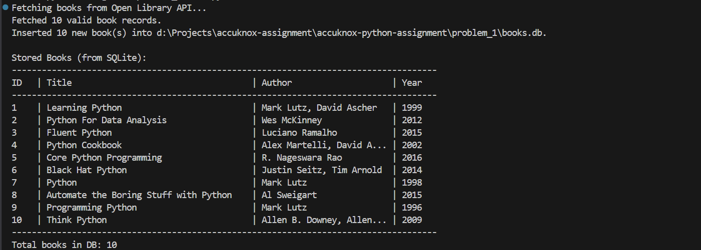

# Problem 1 – API Retrieval and SQLite

A Python script that fetches book records from the Open Library REST API, stores them in a local SQLite database, and reads the stored records back from SQLite to display them.

## What It Does

1. **Fetch from REST API (`requests`)**: Calls `https://openlibrary.org/search.json` and checks the HTTP status and JSON structure (`docs`).
2. **Store in SQLite (`sqlite3`)**: Creates a `books` table in `books.db` and inserts records using parameterised SQL queries (`?` placeholders) with `INSERT OR IGNORE` to avoid duplicate entries.
3. **Read & Display from SQLite**: Queries the `books` table with `SELECT` and prints the results in a table.
4. **Error Handling**: Catches `requests` network/HTTP/timeout errors, JSON/data validation errors, and `sqlite3.Error`.

## How to Run

Install `requests` if not already installed:

```bash
pip install requests
```

Run the script:

```bash
python main.py
```

## Sample Output


