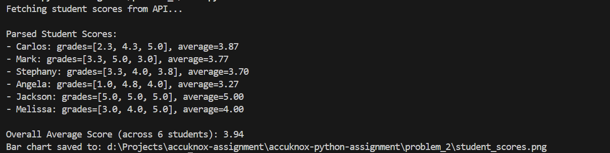
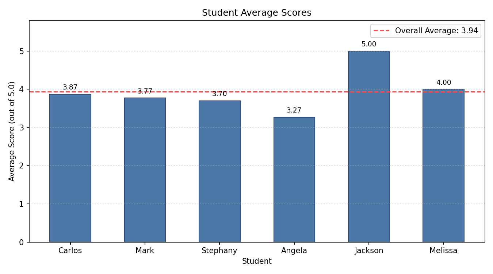

# Problem 2 – Data Processing and Visualization

A Python script that fetches student score data from a REST API, parses the JSON response, calculates the average score across all fetched records, and saves a Matplotlib bar chart as an image.

## What It Does

1. **Fetch from API (`requests`)**: Retrieves student records in JSON format from `https://raw.githubusercontent.com/stivenson/students-api/master/students.json`.
2. **Parse & Validate JSON**: Extracts each student's name and list of grades, and computes each student's average score.
3. **Calculate Overall Average**: Computes the arithmetic mean across all fetched student records.
4. **Generate & Save Bar Chart (`matplotlib`)**: Plots each student's average score as a bar, overlays a dashed line for the overall average, and saves the figure to `student_scores.png`.

## How to Run

Install dependencies if not already installed:

```bash
pip install requests matplotlib
```

Run the script:

```bash
python main.py
```

## Output

Running the script prints each student's parsed grades and the overall average score in the terminal, and saves the bar chart image to `student_scores.png`:

### Console Output



### Bar Chart


