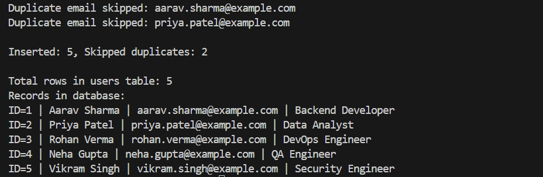

# Problem 3 – CSV Import into SQLite

A Python script that reads user records from `users.csv`, stores them in a local SQLite database while skipping duplicate email addresses, and queries the database back to verify the saved records.

## What It Does

1. **Read CSV (`csv`)**: Reads rows from `users.csv` using `csv.DictReader`.
2. **Create Table & Insert (`sqlite3`)**: Creates a `users` table with `email` marked `UNIQUE` and inserts records using parameterised SQL queries (`?` placeholders).
3. **Handle Duplicate Emails**: Catches `sqlite3.IntegrityError` when a duplicate email is encountered and skips it cleanly.
4. **Verify Inserted Records**: Opens a fresh SQLite connection to `users.db`, checks `COUNT(*)`, and queries the persisted rows from the `users` table.

## How to Run

No external packages are required (uses Python's standard library).

```bash
python main.py
```

## Sample Output


